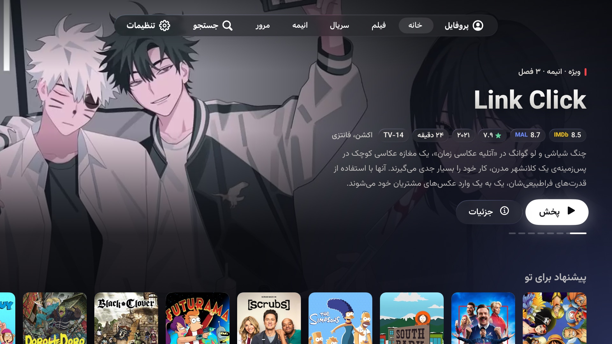
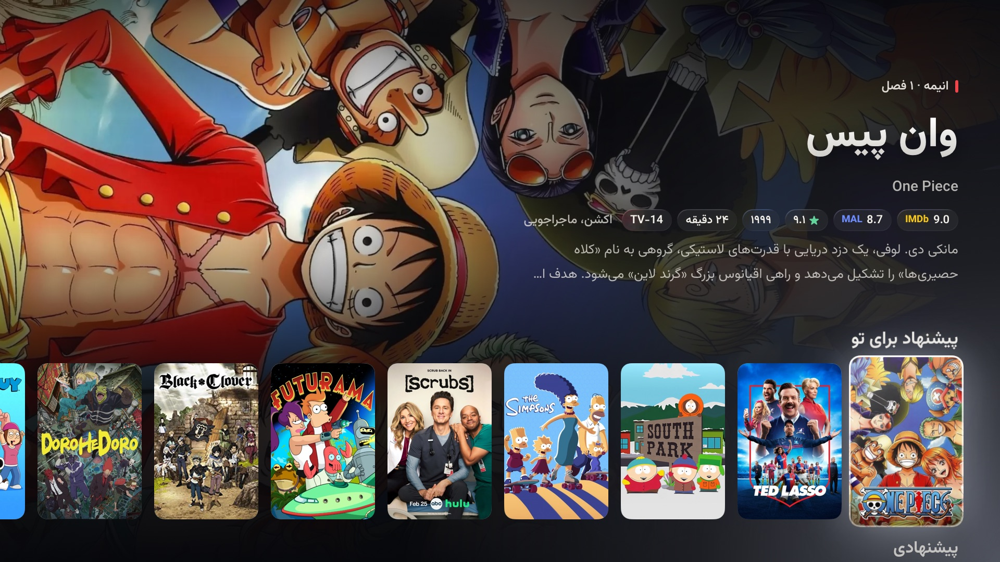
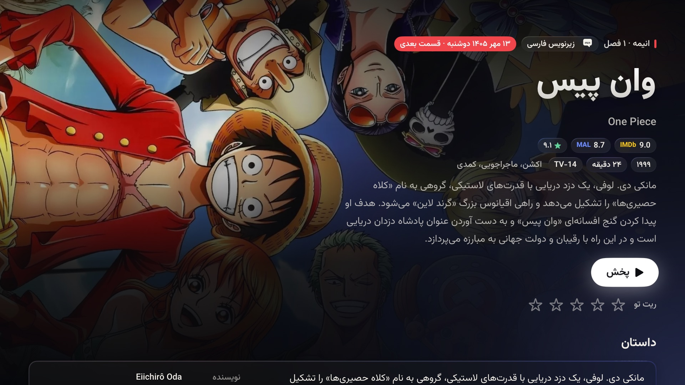
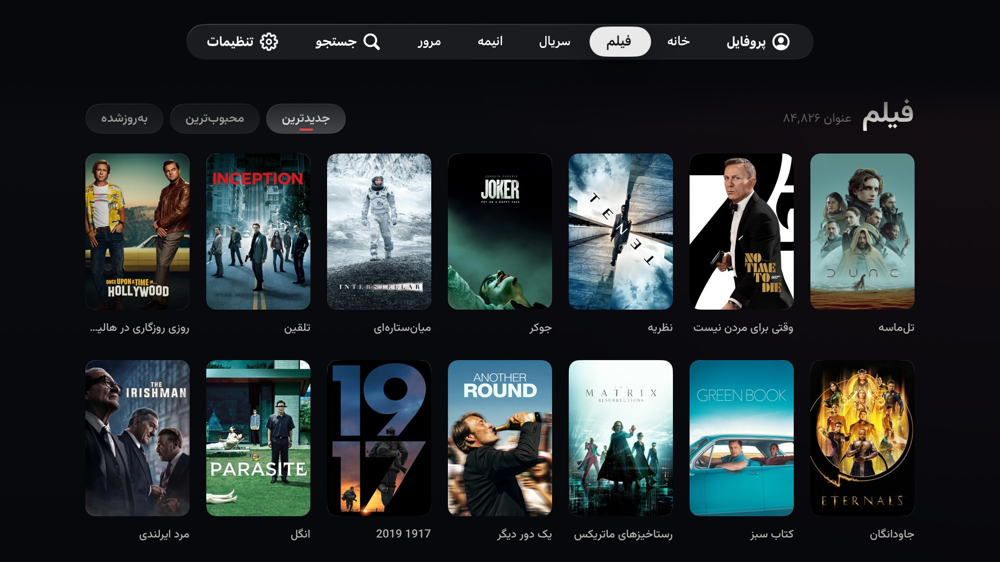
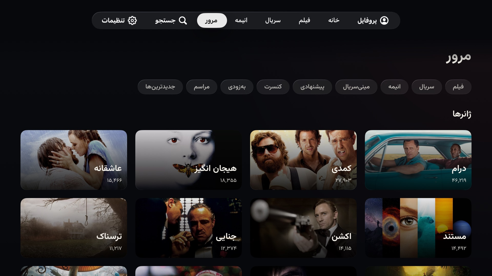
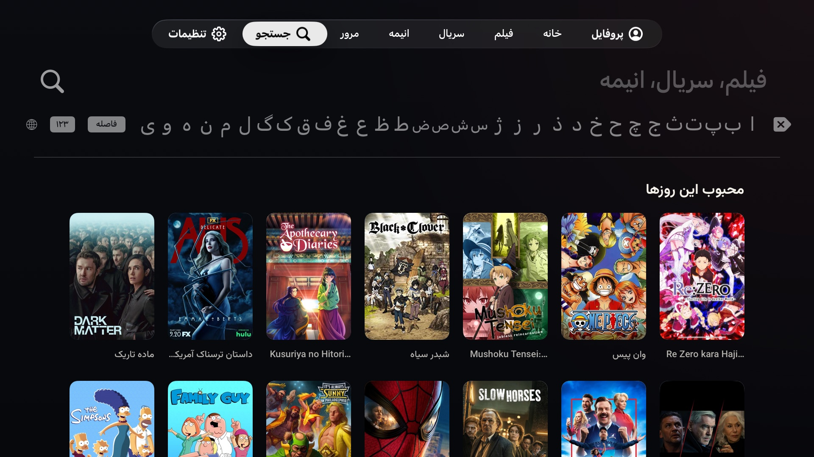
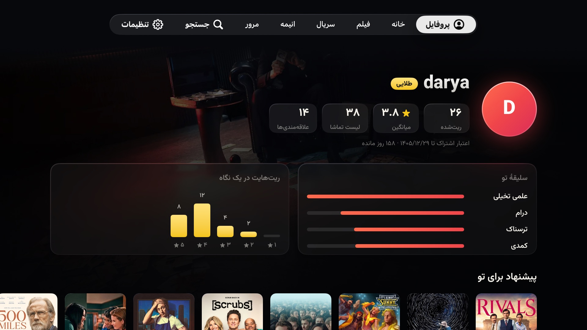
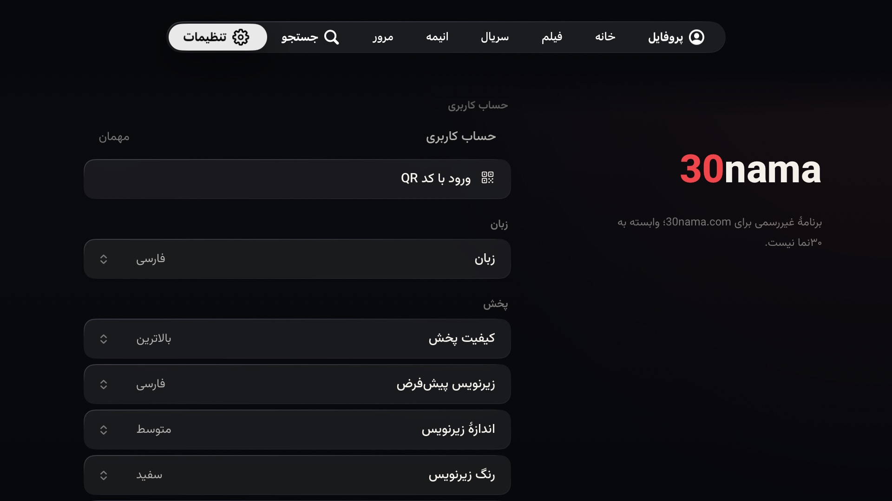

<div dir="rtl">

# ۳۰نما برای Apple TV

برنامه‌ای بومی برای tvOS که کاتالوگ [30nama.com](https://30nama.com) را روی Apple TV می‌آورد. با SwiftUI نوشته شده است.

این برنامه بر پایهٔ کلاینت تایزن [msharifi99/30nama-tizenos](https://github.com/msharifi99/30nama-tizenos) ساخته شده است. جزئیات در بخش [اعتبار](#اعتبار).

> **این برنامه رسمی نیست.** ساختهٔ ۳۰نما نیست، وابستگی یا ارتباطی با ۳۰نما ندارد و ۳۰نما آن را تأیید نکرده است. برای پخش باید اشتراک خودتان را در ۳۰نما داشته باشید. بدون ورود فقط می‌شود فهرست‌ها را دید.

> **پروژه در حال توسعه است** و مرتب به‌روز می‌شود، پس ممکن است بعضی بخش‌ها ناقص باشند یا تغییر کنند. اگر می‌خواهید همکاری کنید، بخش [همکاری](#همکاری) را ببینید.

## تصویرها

| خانه | ردیف‌ها |
|---|---|
|  |  |

| جزئیات | فیلم‌ها |
|---|---|
|  |  |

| مرور ژانرها | جستجو |
|---|---|
|  |  |

| پروفایل | تنظیمات |
|---|---|
|  |  |

## امکانات

- ورود با کد QR، یا مرور به‌عنوان مهمان
- خانه با چرخ‌فلک عنوان‌های ویژه، بیلبوردی که با حرکت فوکوس عوض می‌شود و پس‌زمینه‌ای که به تصویر همان عنوان محو می‌شود
- صفحهٔ جزئیات با فصل‌ها و قسمت‌ها، بازیگران و ادامهٔ تماشا
- فهرست فیلم، سریال و انیمه با مرتب‌سازی، مرور ژانرها و جستجو
- پخش‌کنندهٔ خود سیستم با زیرنویس فارسی و انگلیسی به قلم وزیرمتن (اندازه، رنگ و پس‌زمینهٔ زیرنویس قابل تنظیم است)، دکمه‌های رد کردن تیتراژ و قسمت بعد، انتخاب کیفیت
- ستاره دادن به عنوان‌ها و صفحهٔ پروفایل با پیشنهادهایی که از روی همین ستاره‌ها ساخته می‌شود. ستاره‌ها در iCloud خود کاربر هم نگه داشته می‌شوند تا بین چند Apple TV یکی بمانند (این بخش با iCloud واقعی آزموده شده، ولی هنوز روی Apple TV واقعی نه).
- ردیف‌های ترند از TMDB (اختیاری، توضیح در پایین)
- رابط فارسی (راست‌به‌چپ) و انگلیسی

## اجرا

Xcode 26 با پلتفرم tvOS لازم است. برنامه روی tvOS 17 به بالا اجرا می‌شود.

۱. فایل `30nama.xcodeproj` را باز کنید.

۲. یک شبیه‌ساز Apple TV انتخاب کنید و Run را بزنید. برای شبیه‌ساز کار دیگری لازم نیست.

۳. برای اجرا روی خود Apple TV، فایل `Config/Local.example.xcconfig` را با نام `Config/Local.xcconfig` کپی کنید و شناسهٔ تیم اپل خودتان را در آن بنویسید. این فایل در گیت ثبت نمی‌شود. شناسهٔ برنامه (`app.30nama.tv`) و کانتینر iCloud در `Config/30nama.entitlements` را هم باید به نام خودتان تغییر دهید.

### ردیف‌های ترند (اختیاری)

سه ردیف «پرطرفدار این هفته»، «سریال‌های جدید و ادامه‌دار» و «فیلم‌های محبوب امروز» از فهرست‌های TMDB ساخته می‌شوند: برنامه فهرست را از TMDB می‌گیرد و هر عنوان را در خود ۳۰نما جستجو می‌کند. فقط عنوان‌هایی نشان داده می‌شوند که در ۳۰نما پیدا شوند.

برای روشن شدنش یک توکن رایگان TMDB لازم است (در themoviedb.org از مسیر Settings و بعد API، مقدار «API Read Access Token»). آن را در `Config/Local.xcconfig` جلوی `TMDB_TOKEN` بگذارید و دوباره بیلد کنید. بدون توکن، برنامه مثل قبل کار می‌کند و این ردیف‌ها دیده نمی‌شوند.

توکن فقط در بیلد Debug داخل برنامه نوشته می‌شود. هر چیزی که داخل برنامه باشد از آن قابل بیرون کشیدن است، پس بیلد Release (آرشیو، TestFlight، App Store) بدون توکن ساخته می‌شود و ردیف‌های ترند در آن خاموش است.

برای دیدن ردیف‌ها بدون توکن، در بیلد Debug متغیر محیطی `NAMA_TMDB_MOCK` را برابر مسیر پوشه‌ای بگذارید که پاسخ‌های ذخیره‌شدهٔ TMDB در آن است (`trending.json`، `on_the_air.json` و `now_playing.json`؛ کلاینت تایزن یک نمونه در `tizen-app/tools/fixtures` دارد). جستجو در ۳۰نما همچنان واقعی انجام می‌شود.

### امتحان پخش‌کننده بدون اشتراک

در بیلد Debug متغیر محیطی `NAMA_DEMO=1` را به Scheme اضافه کنید. آن‌وقت هر عنوان، ویدیوی آزمایشی اپل را با زیرنویس و قسمت‌های نمونه پخش می‌کند.

## تست‌ها

هستهٔ برنامه (مدل‌ها، کلاینت API، تجزیهٔ زیرنویس و BlurHash، تطبیق عنوان‌های TMDB، ادغام ریت‌ها) به رابط کاربری وابسته نیست و به شکل یک پکیج Swift هم ساخته می‌شود. تست‌هایش روی مک اجرا می‌شوند:

<div dir="ltr">

```
swift test
```

</div>

## ساختار

<div dir="ltr">

```
30nama/Core      models, API client, parsers, strings, TMDB matching (no UI imports; shared with the test package)
30nama/App       app entry, app-wide state, routes, iCloud store, debug stand-ins
30nama/UI        theme, focus styles, image pipeline, backdrop
30nama/Screens   login, home, details, catalogue grid, browse, search, profile, settings
30nama/Player    AVKit player, subtitles, menus
Config           Info.plist additions, entitlements, build settings
Tools            make-icons.swift (regenerates the app icon and Top Shelf images from 30nama-logo.png)
Tests            tests for 30nama/Core
```

</div>

## همکاری

کمک شما خوش‌آمد است، چه گزارش یک ایراد باشد چه کد.

- ایراد یا پیشنهادی دارید؟ یک Issue باز کنید.
- می‌خواهید کد بنویسید؟ فهرست کارهای باز در [TASKS.md](TASKS.md) است. اگر کار بزرگی در نظر دارید، قبلش در یک Issue بگویید تا دوباره‌کاری نشود.
- قبل از فرستادن Pull Request دستور `swift test` را اجرا کنید. قاعده‌های کد در [AGENTS.md](AGENTS.md) آمده است.

## مجوز

کد این پروژه با مجوز [MIT](LICENSE) منتشر شده است. نام و لوگوی ۳۰نما، قلم وزیرمتن و بخش‌هایی که از پروژه‌های دیگر آمده‌اند مجوز خودشان را دارند که در [THIRD-PARTY-NOTICES.md](THIRD-PARTY-NOTICES.md) آمده است.

## اعتبار

- این برنامه از روی کلاینت تایزن [msharifi99/30nama-tizenos](https://github.com/msharifi99/30nama-tizenos) نوشتهٔ Rebin Sharifi ساخته شده است: همان API، با برنامه‌ای تازه. منطق ردیف‌های ترند برگردان `tmdb.js` همان پروژه است. متن مجوز آن در [THIRD-PARTY-NOTICES.md](THIRD-PARTY-NOTICES.md) آمده است.
- قلم [وزیرمتن](https://github.com/rastikerdar/vazirmatn) با مجوز SIL Open Font License منتشر شده است.
- این برنامه از API سایت TMDB استفاده می‌کند ولی TMDB آن را تأیید یا گواهی نکرده است.
- نام و لوگوی ۳۰نما متعلق به ۳۰نما است. لوگو روی آیکون برنامه فقط برای این است که معلوم باشد برنامه به کدام سرویس وصل می‌شود، و نشانهٔ تأیید یا همکاری ۳۰نما نیست.
- پوسترها و تصویرهایی که در برنامه و در این صفحه می‌بینید متعلق به صاحبان همان آثار است.

</div>
